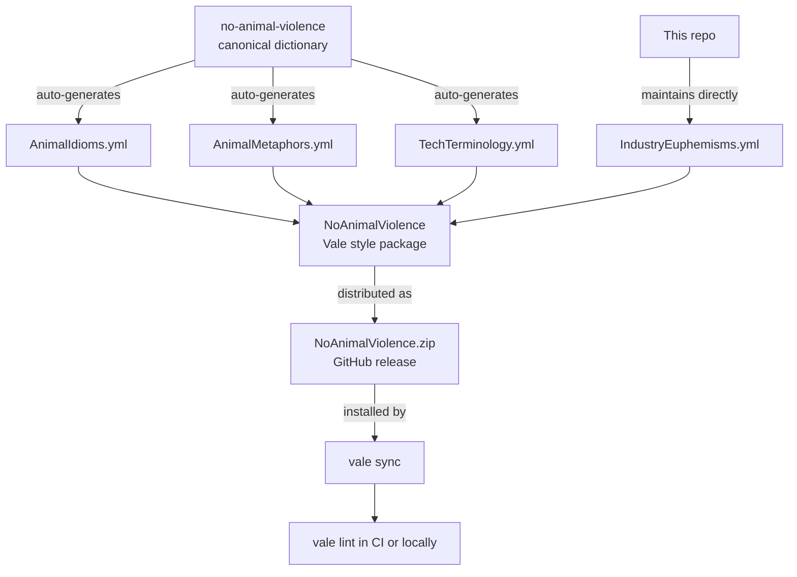

# No Animal Violence — Vale Style Package


A [Vale](https://vale.sh) style package that detects speciesist language in prose and documentation, then suggests clearer, more accurate alternatives. It is built for developer teams, doc engineers, and anyone who reviews prose in CI. The rules cover violent idioms, animal-as-object metaphors, animal agriculture euphemisms, and technical terms with precise alternatives. Each flagged phrase comes with a concrete suggested replacement derived from the [no-animal-violence canonical rule dictionary](https://github.com/Open-Paws/no-animal-violence).

> [!NOTE]
> This project is part of the [Open Paws](https://openpaws.ai) ecosystem — AI infrastructure for the animal liberation movement. [Explore the full platform →](https://github.com/Open-Paws)
>
> Language that normalizes harm toward animals appears throughout technical writing — from idioms in blog posts to euphemisms in config comments. This package makes that language visible and replaceable, across any project that runs Vale.

## Quickstart

```bash
# 1. Install Vale
brew install vale          # macOS
# See https://vale.sh/docs/install for Linux and Windows

# 2. Add to .vale.ini
# Packages = https://github.com/Open-Paws/vale-no-animal-violence/releases/latest/download/NoAnimalViolence.zip
# [*]
# BasedOnStyles = NoAnimalViolence

# 3. Sync and lint
vale sync
vale docs/ README.md
```

## Features

- **4 rule sets** covering idioms, metaphors, industry euphemisms, and tech terminology
- **Vale substitution extension** — every flagged phrase has a concrete replacement, not just a warning
- **Case-insensitive matching** across all rules
- **Configurable per file type** — enable or disable individual rules via `.vale.ini`
- **CI-ready** — works with GitHub Actions (`errata-ai/vale-action`), GitLab CI, and pre-commit hooks
- **Downstream consumer of the canonical dictionary** — `AnimalIdioms.yml`, `AnimalMetaphors.yml`, and `TechTerminology.yml` are auto-generated from [no-animal-violence](https://github.com/Open-Paws/no-animal-violence); `IndustryEuphemisms.yml` is maintained directly in this repo
- **Legacy `Speciesism` package** distributed alongside `NoAnimalViolence` for backwards compatibility

### Rules reference

| Rule | Level | Examples flagged |
|------|-------|-----------------|
| `NoAnimalViolence.AnimalIdioms` | warning | "kill two birds with one stone", "beat a dead horse", "guinea pig", "like lambs to the slaughter" |
| `NoAnimalViolence.AnimalMetaphors` | warning | "cattle vs. pets", "canary in a coal mine", "sacred cow", "cash cow", "scapegoat" |
| `NoAnimalViolence.IndustryEuphemisms` | warning | "livestock", "processing plant", "gestation crate", "depopulation", "humane slaughter" |
| `NoAnimalViolence.TechTerminology` | suggestion | "master/slave", "whitelist/blacklist", "grandfathered" |

### Sample output

```
README.md
 14:5  warning   Consider using 'accomplish two things at once'    NoAnimalViolence.AnimalIdioms
                 instead of 'kill two birds with one stone'.
 22:1  warning   Consider using 'slaughterhouse' instead of        NoAnimalViolence.IndustryEuphemisms
                 'processing plant'.
 31:3  suggestion  Consider using 'primary/replica' instead of     NoAnimalViolence.TechTerminology
                   'master/slave'.
```

## Documentation

- [Configuration options](#configuration)
- [CI integration examples](#ci-integration)
- [Contributing guide](#contributing)
- [Relationship to the canonical rules — architecture section below](#architecture)
- [Canonical rule dictionary](https://github.com/Open-Paws/no-animal-violence)

## Configuration

### Enable all rules (recommended)

```ini
StylesPath = styles
MinAlertLevel = suggestion

Packages = https://github.com/Open-Paws/vale-no-animal-violence/releases/latest/download/NoAnimalViolence.zip

[*]
BasedOnStyles = NoAnimalViolence
```

### Enable specific rules only

```ini
[*]
NoAnimalViolence.AnimalIdioms = YES
NoAnimalViolence.AnimalMetaphors = YES
NoAnimalViolence.IndustryEuphemisms = YES
NoAnimalViolence.TechTerminology = NO
```

### Scope to specific file types

```ini
[*.md]
BasedOnStyles = NoAnimalViolence

[*.txt]
NoAnimalViolence.AnimalIdioms = YES
```

### Combine with other styles

```ini
Packages = https://github.com/Open-Paws/vale-no-animal-violence/releases/latest/download/NoAnimalViolence.zip,
           https://github.com/errata-ai/Google/releases/latest/download/Google.zip

[*]
BasedOnStyles = NoAnimalViolence, Google
```

## CI Integration

### GitHub Actions (recommended)

```yaml
name: Vale Prose Lint
on:
  pull_request:
  push:
    branches: [main]

jobs:
  vale:
    runs-on: ubuntu-latest
    steps:
      - uses: actions/checkout@v4
      - name: Run Vale
        uses: errata-ai/vale-action@reviewdog
        with:
          files: '["docs/", "README.md"]'
          reporter: github-pr-review
        env:
          GITHUB_TOKEN: ${{ secrets.GITHUB_TOKEN }}
```

### Pre-commit hook

```yaml
repos:
  - repo: https://github.com/errata-ai/vale
    rev: v3.4.2
    hooks:
      - id: vale
        files: \.(md|txt|rst)$
```

### GitLab CI

```yaml
vale:
  image: jdkato/vale:latest
  script:
    - vale sync
    - vale docs/ README.md
  rules:
    - if: $CI_PIPELINE_SOURCE == "merge_request_event"
```

<details>
<summary>Architecture</summary>



Rule files marked `# AUTO-GENERATED from project-compassionate-code. Do not edit directly.` are generated from the [no-animal-violence](https://github.com/Open-Paws/no-animal-violence) canonical dictionary via [project-compassionate-code](https://github.com/Open-Paws/project-compassionate-code). Submit pattern changes upstream to `no-animal-violence`. `IndustryEuphemisms.yml` is maintained in this repo.

**Speciesist language detection suite — coverage by layer**

| Layer | Tool |
|-------|------|
| Prose / documentation | **This package (Vale)** |
| JavaScript / TypeScript | [eslint-plugin-no-animal-violence](https://github.com/Open-Paws/eslint-plugin-no-animal-violence) |
| Python, Go, multi-language | [semgrep-rules-no-animal-violence](https://github.com/Open-Paws/semgrep-rules-no-animal-violence) |
| Pre-commit hooks | [no-animal-violence-pre-commit](https://github.com/Open-Paws/no-animal-violence-pre-commit) |
| GitHub Actions | [no-animal-violence-action](https://github.com/Open-Paws/no-animal-violence-action) |

</details>

## Contributing

Contributions are welcome. What is most needed:

- New industry euphemisms belong in `NoAnimalViolence/IndustryEuphemisms.yml` — edit directly in this repo
- New idioms or metaphors belong upstream in [no-animal-violence](https://github.com/Open-Paws/no-animal-violence)
- Each rule entry requires: the flagged phrase, a concrete replacement, a severity level (`warning` or `suggestion`), and a link to supporting evidence

**Adding a rule entry:**

```yaml
extends: substitution
message: "Consider using '%s' instead of '%s'. <reason>"
level: warning
ignorecase: true
swap:
  flagged phrase: suggested replacement
```

Test locally before opening a PR:

```bash
vale --config .vale.ini README.md
yamllint NoAnimalViolence/
```

Open a PR against `main`. The auto-merge workflow handles merging once checks pass.

## License

MIT — see [LICENSE](LICENSE). Copyright (c) 2026 Open Paws.

The pattern selection is grounded in peer-reviewed research on speciesist language and AI bias:
- Hagendorff, Bossert, Tse & Singer (2023). "Speciesist bias in AI." *AI and Ethics*. [doi:10.1007/s43681-023-00380-w](https://doi.org/10.1007/s43681-023-00380-w)

---

[Donate](https://openpaws.ai/donate) · [Discord](https://discord.gg/openpaws) · [openpaws.ai](https://openpaws.ai) · [Volunteer](https://openpaws.ai/volunteer)

---

```yaml
tech_stack: [vale, yaml]
project_status: alpha
difficulty: beginner
skill_tags: [prose-linting, speciesist-language, documentation, ci-cd]
related_repos:
  - https://github.com/Open-Paws/no-animal-violence
  - https://github.com/Open-Paws/eslint-plugin-no-animal-violence
  - https://github.com/Open-Paws/semgrep-rules-no-animal-violence
  - https://github.com/Open-Paws/no-animal-violence-pre-commit
  - https://github.com/Open-Paws/no-animal-violence-action
```
